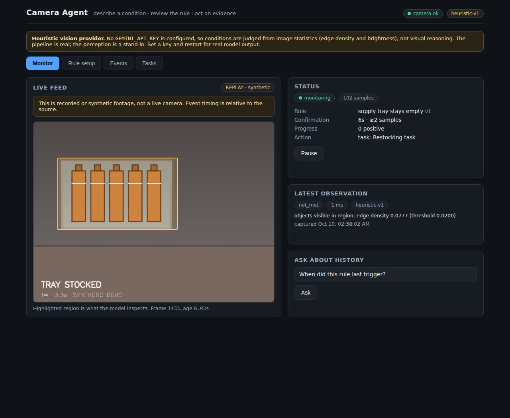

# hacklanta-project

> **Hacklanta 2026, 2nd place.** This is my early prototype of the camera-to-workflow agent. Our 4-person team's final submission, **Vigil**, lives at [Hossam-Ismail/vigil](https://github.com/Hossam-Ismail/vigil); we built it together on a shared laptop, so its commits sit under one teammate's account.

A camera-to-workflow agent. Point a camera at something, describe a condition
in plain English, review the compiled rule, and get a task or webhook with
evidence when the condition actually holds.

Built from the four-person 48-hour build plan. Inspired by OpenVector's public
product flow; this is an independent implementation, not their architecture.

**Status: end-to-end working.** Camera → vision → confirmation → action →
evidence → history all run. **175 unit/integration tests pass**, and a
**13/13 live acceptance run** against the real HTTP API is recorded in
[`docs/acceptance-results.md`](docs/acceptance-results.md).



---

## Run it

**Node.js is not required to run the app.** The compiled UI is committed under
`frontend/dist` and served by the backend, so you need Python only.

### Windows

Double-click **`scripts\run.bat`**, or from `cmd`:

```bat
cd /d "%USERPROFILE%\hacklanta-project"
scripts\run.bat
```

It creates the virtual environment, installs dependencies, copies `.env`, and
starts the app. Then open <http://localhost:8000>.

If you get `'python' is not recognized`, install Python from
<https://www.python.org/downloads/> and tick **"Add python.exe to PATH"**
during setup.

**If the install fails with `cargo`, `maturin` or "failed building wheel":**
pip could not find a prebuilt wheel for your Python version and tried to
compile `pydantic-core` and `pillow` from source, which needs a Rust
toolchain. Check `python --version`; install **Python 3.12**, delete the
`.venv` folder, and run the script again. `requirements.txt` uses version
ranges precisely so pip can pick wheels that match your interpreter — pinned
versions are in `requirements-lock.txt` if you want an exact reproduction.

### macOS / Linux

```bash
python -m venv .venv
.venv/bin/pip install --prefer-binary -r requirements.txt
cp .env.example .env            # works as-is; add GEMINI_API_KEY for real vision
cd backend && ../.venv/bin/python -m uvicorn app.main:app --port 8000
```

Needs **Python 3.10+**. `--prefer-binary` keeps pip on prebuilt wheels rather
than compiling `pydantic-core` and `pillow` from source.

Then open <http://localhost:8000>.

To exercise the webhook action, run the test receiver in a second terminal:

```bash
cd backend && ../.venv/bin/python -m uvicorn app.receiver:app --port 9000
```

### Developing the frontend

Only this needs Node. `scripts/dev.sh` runs all three processes with Vite's
dev server and hot reload on <http://localhost:5173>:

```bash
cd frontend && npm install && cd ..
./scripts/dev.sh
```

After changing frontend code, rebuild the committed bundle so the
Python-only path stays current:

```bash
cd frontend && npm run build
```

---

Once it is running, go to **Rule setup** and paste:

> If the supply tray stays empty for 10 seconds, create a restocking task.

Review the compiled cards, draw a region, press **Activate**, and watch the
Monitor screen move `monitoring → confirming → event active`. The event, its
snapshot, its clip and its task receipt appear under **Events**.

Tests and the live acceptance run:

```bash
python -m pytest -q                 # 175 tests, ~5s, no camera/model/network
python scripts/acceptance.py        # live HTTP run; writes docs/acceptance-results.md
```

---

## What it does

```
      capture thread                asyncio
┌──────────────────┐   latest   ┌──────────────┐  crop  ┌──────────────┐
│ usb / file /     │─ frame ───▶│ InferenceWkr │───────▶│ vision       │
│ synthetic source │  (no queue)│  1 in flight │        │ gemini|heur. │
└────────┬─────────┘            └──────┬───────┘        └──────┬───────┘
         │ rolling JPEG buffer          │ Observation           │ met/not_met/unknown
         ▼                              ▼                       │
   ┌───────────┐              ┌──────────────────┐ ◀────────────┘
   │ evidence  │◀─ snapshot ──│ engine (pure)    │
   │ clip/jpg  │   + clip     │ IDLE/CAND/ACTIVE │
   └───────────┘              └────────┬─────────┘
                                       │ TRIGGER_EVENT
                                       ▼
                         ┌──────────────────────────┐
                         │ SQLite: event + pending  │  one transaction
                         │ action, UNIQUE episode   │
                         └────────────┬─────────────┘
                                      ▼
                            dispatcher → task | webhook
```

| Screen | What it shows |
|---|---|
| **Monitor** | Live feed, region overlay, inference state, latest verdict, history questions |
| **Rule setup** | Instruction → editable Camera / Condition / Confirmation / Action cards, region drawing, exact-crop preview |
| **Events** | Chronological cards: explanation, timings, episode, receipt, snapshot, clip |
| **Tasks** | Open/completed tasks with evidence, and retry for failed deliveries |

[Rule setup](docs/screenshots/02-rule-setup.png) ·
[Events](docs/screenshots/03-events.png) ·
[Tasks](docs/screenshots/04-tasks.png)

---

## The decisions worth reviewing

### The engine is pure, so the hard behaviour is cheap to test

`transition(episode, observation, workflow) -> (episode, effect)` has no clock,
no I/O and no database. Every row of the plan's state table and acceptance
table is reachable from synthetic timestamped observations, so a ten-second
confirmation — or a five-minute one — tests in microseconds. That is why
`test_engine.py` can assert things like *a condition held for five minutes
fires exactly once at every sampling interval from 0.5s to 4.9s*.

### Duration uses a monotonic clock; display uses UTC

Every observation carries `captured_monotonic` and `captured_at_utc`. All timer
arithmetic uses the former, so an NTP correction or DST shift can never
retroactively satisfy a rule. Stored records keep the latter.

### Duplicate prevention is a database constraint

`UNIQUE(workflow_id, episode_id)` on events, `UNIQUE(event_id, type)` on
actions, `UNIQUE(event_id)` on tasks. The event and its **pending** action
commit in one transaction; carrying the action out is the dispatcher's job, so
a crash between them leaves a pending row to recover from rather than an event
with no action. Each confirmation mints a fresh `episode_id`, so re-arming
after a genuine clear produces a genuinely distinct event.

### Delivery is at-least-once, and says so

If a receiver accepts a POST and the response is lost, the retry delivers
again. Every payload carries a stable `idempotency_key` derived only from
`(event_id, action_type)`. Retries are bounded (1s, 2s, 4s); a 4xx other than
408/429 is not retried. The bundled receiver deduplicates on that key — the
acceptance run records `unique=1 deliveries=4 suppressed=3`.

### The model picks a destination id, never a URL

`WebhookAction.destination_id` resolves against a backend allowlist. Scene
text, user instructions and model output cannot steer a request to an arbitrary
host. A test asserts an unknown destination fails with **zero** HTTP requests
attempted.

### `unknown` is not a negative

Timeouts, rate limits, malformed JSON, a dark or near-uniform crop all become
`unknown` — never `not_met`, which would be a claim about the scene.

- While `CANDIDATE`: resets the streak, so intermittent obstruction can never
  complete a timer.
- While `ACTIVE`: holds the episode, marks it `condition_unverified`, resets the
  clear streak, and does **not** re-arm. Losing sight of something is not
  evidence it ended.

### The compiler is deterministic

Rule compilation is a small, closed classification problem, so it is a parser,
not a model call: auditable, instant, free, and unable to hallucinate a
capability. It asks when the target, duration or action is missing, and
explains when a request is out of scope rather than approximating it. It never
generates executable code and never auto-activates — `enabled` is always `false`
on a draft.

### The UI cannot imply a verdict it does not have

Preview rate and analysis rate are separate. The status label reports the
*inference* path: `paused`, `not running`, `starting`, `monitoring`,
`confirming`, `event active`, `unverified`, `uncertain`, `disconnected`,
`stale`. A non-USB source is labelled **REPLAY**, never live. Region drawing
converts pointer positions into normalized image coordinates against the
image's displayed content box, so letterboxing cannot skew the region away from
what the model is actually given.

---

## Vision providers

| Provider | When | Honest description |
|---|---|---|
| `gemini` | `GEMINI_API_KEY` set | Hosted vision, schema-constrained JSON, temperature 0 |
| `heuristic` | no key (default) | **Not visual reasoning.** Judges region occupancy from Canny edge density and intensity spread |

The heuristic provider exists so the entire pipeline is runnable and testable
with no key and no network, and so CI exercises the real code path. It reports
`model_id: heuristic-v1`, `/api/health` returns `using_real_model: false`, and
the UI shows a standing banner. It is a stand-in, labelled as one everywhere.

The evaluator prompt tells the model to treat scene text as image content and
not as instructions, to never reason about elapsed time, and to return
`unknown` when ambiguous. Output is constrained to a three-value enum, so the
worst a prompt-injected sign can do is produce a wrong verdict, never a
different action.

---

## Tested

```
175 passed in ~5s
```

| File | Covers |
|---|---|
| `test_engine.py` | Every state-table row, guards, health, restart, sampling-rate properties |
| `test_db.py` | Duplicate prevention, atomic commit, restart recovery, versioning |
| `test_actions.py` | Allowlist, idempotency, bounded backoff, 4xx vs 5xx, honest failure |
| `test_integration.py` | Full spine with real SQLite, real JPEG and real MP4 encoding |
| `test_compiler.py` | Durations, classification, unsupported requests, no auto-activation |
| `test_vision.py` | Prompt guards, verdict validation, occupied/empty/covered separation |
| `test_pipeline.py` | Capture worker, frame dedup, disconnection, end-to-end tick |
| `test_history.py` | Deterministic counts, "no records" ≠ "nothing happened", no SQL from text |
| `test_api.py` | Every route, version bumping, path-traversal refusal, honest status |
| `test_fixtures.py` | Fixtures round-trip through the schemas (contract-drift guard) |

No test touches a camera, a model, or the network.

---

## Known limits — read before demoing

- **The USB path has never been executed.** Development had no `/dev/video*`.
  `cv2.VideoCapture` is written correctly but unverified; test it on the demo
  laptop first. That is what the plan's hour-4 gate is for.
- **No Gemini call has ever run.** No API key was available. The adapter is
  written and its failure paths are tested, but its real output is unverified.
  Calibrate against your own footage before trusting any threshold.
- **The heuristic provider is not vision.** Every number in
  `docs/acceptance-results.md` was produced by it on a synthetic scene. Re-run
  with a real model and real footage before quoting any of it.
- **Confirmation is across samples, not continuous.** A condition is confirmed
  over sampled observations, never proven for every instant between frames.
- **One active workflow is the tested path.** Multiple rules run, but were not
  benchmarked.
- **RTSP is a stretch input**, mapped onto the file source. Not a promise that
  any particular camera works.
- Not built: custom model training, multi-camera tracking, computer-use
  automation, graph-shaped workflows, real business connectors.

---

## Layout

```
backend/app/
  schemas.py    contracts (frozen; fixtures generated from these)
  engine.py     pure event state machine
  db.py         SQLite, WAL, serialized writes
  actions.py    tasks + webhooks, allowlist, bounded retry
  evidence.py   rolling buffer, snapshots, clips
  runtime.py    wires engine + storage + effects
  camera.py     capture worker, pluggable sources
  vision.py     Gemini + heuristic + scripted providers
  compiler.py   plain English -> validated rule
  pipeline.py   sampling policy, one inference in flight
  history.py    parameterized question answering
  main.py       FastAPI routes and worker lifecycle
  receiver.py   test webhook receiver (deduplicates)
  demo.py       synthetic scene + demo video generator
frontend/src/   React + TypeScript, four screens
fixtures/       JSON contracts + demo_tray.mp4
scripts/        dev.sh, acceptance.py, gen_fixtures.py
```

Regenerate fixtures after any schema change:

```bash
python scripts/gen_fixtures.py && python -m pytest tests/test_fixtures.py -q
```

## Configuration

Copy `.env.example` to `.env` — it is gitignored; never commit a real key.
Pin `VISION_MODEL` to the exact id you calibrate against and do not change it
afterwards. Run the backend with **one** uvicorn worker and without autoreload:
a single process must own the camera.
